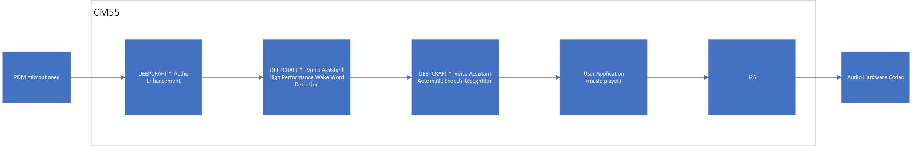
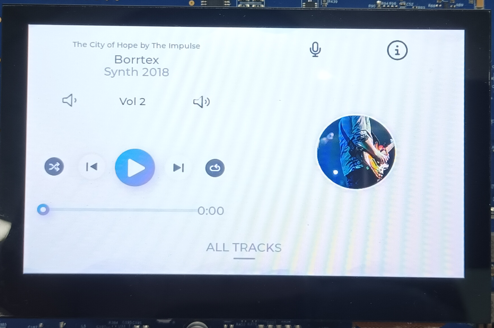
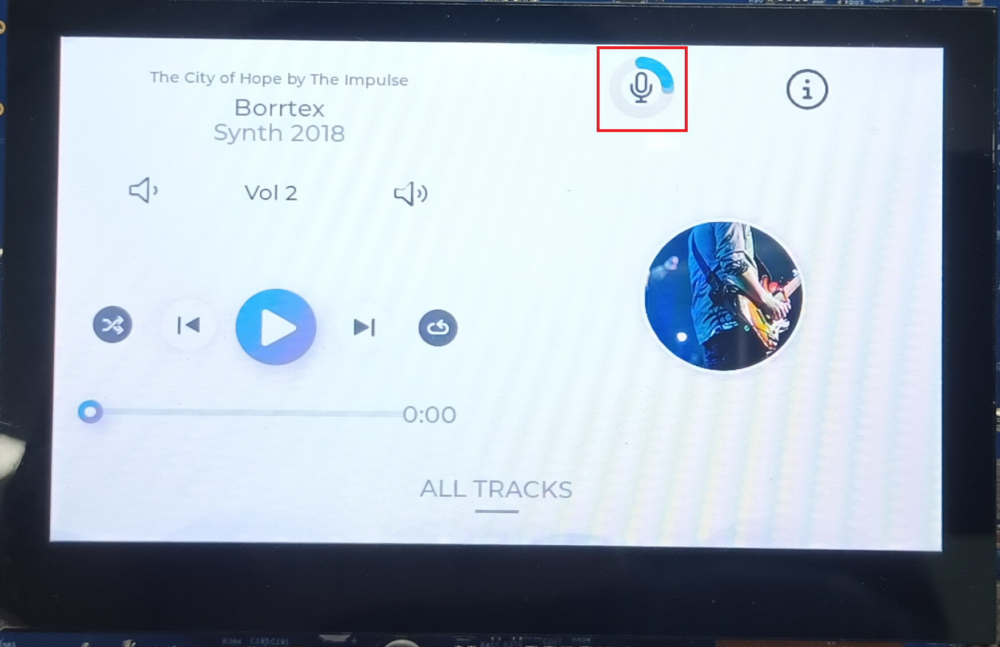
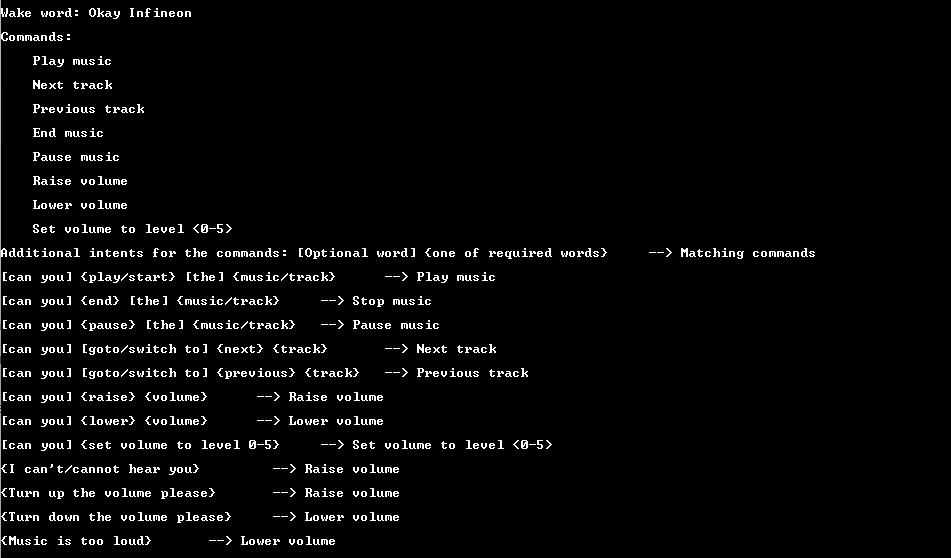

# PSOC&trade; Edge MCU: Mains-powered local voice

This code example illustrates Infineon's PSOC&trade; Edge MCU's "local voice", which refers to its ability to perform speech recognition, audio processing, inferencing, and triggering actions locally at the edge, without relying on cloud connectivity or external servers.

This example showcases Infineon’s comprehensive solution for voice and audio applications with PSOC&trade; Edge MCU. It demonstrates how to use an audio pipeline on the Arm&reg; Cortex&reg; M55 core starting from audio capture, audio data processing with Infineon's DEEPCRAFT&trade; audio enhancement (AE), audio data inferencing with Infineon's DEEPCRAFT&trade; voice assistant (VA), post processing of inferred results, and performing actions based on the results. Both VA and AE components (noise suppression and echo suppression) utilize Ethos-U55.

The use case given in this code example is a music player with 2D graphics with "Okay/Ok Infineon" as the wakeword and several commands/intents. Refer and customize this code example for any use case.

The following image shows a high-level overview of the audio pipeline:

**Figure 1. Audio pipeline**

This code example has a three project structure - CM33 Secure, CM33 Non-Secure, and CM55 projects. All three projects are programmed to the external Octal SPI (OSPI) flash and executed in XIP mode. Critical codes are executed from SoCMEM and Tightly Coupled Memories (TCM). Extended Boot launches the custom CM33 Secure project loaded to RRAM , which then configures the protection settings, OSPI flash and launches the CM33 Non-Secure application. Additionally, CM33 Non-Secure application enables CM55 CPU and launches the CM55 application.

The example uses Peripheral Driver Library (PDL) for peripherals such as PDM-PCM, LED, I2S, and GPIO. The TLV320DAC3100 codec is used for playing audio data sent via I2S to the onboard loudspeaker. The example also uses 4.3 inch screen (Waveshare 4.3 inch Raspberry-Pi DSI LCD C 800480 pixel display).

> **Note:**

> 1. See [Design Guide](docs/local_voice_design_guide.md) for the detailed description of this code example, its design, various options, and KPI details

> 2. This code example supports only Arm&reg; and LLVM compilers, which you need to install separately. See "Software Setup" section below. It requires the Boot SW should be in the "OFF" position

> 3. The audio-voice-core library and VA inferencing library included in this example has a limited operation of about 15 minutes and 30 minutes respectively. For the unlimited license, contact Infineon support. See [Using the code example](docs/using_the_code_example.md) or *note.md* in *proj_cm55\source\modules\audio_voice_core_lib* for placing the licensed version of libraries within the code folder structure

> 4. On 15 minute timeout, the code will stop. See the Terminal output for more information, reset the board

> 5. To use the mp3 decoder for music player playback, ModusToolbox&trade; Audio SW Codecs Tech Pack should be installed which is a licensed tech pack. Else the music playback will be with wav files. See [Using the code example](docs/using_the_code_example.md)

## Requirements

- [ModusToolbox&trade;](https://www.infineon.com/modustoolbox) v3.7 or later (tested with v3.9)
- Board support package (BSP) minimum required version: 1.0.0
- Programming language: C
- Associated parts: All [PSOC&trade; Edge MCU](https://www.infineon.com/products/microcontroller/32-bit-psoc-arm-cortex/32-bit-psoc-edge-arm) parts

## Supported toolchains (make variable 'TOOLCHAIN')

- Arm&reg; Compiler v6.22 (`ARM`)
- LLVM Embedded Toolchain for Arm&reg; v19.1.5 (`LLVM_ARM`) – Default value of `TOOLCHAIN`

## Supported kits (make variable 'TARGET')

- [PSOC&trade; Edge E84 Evaluation Kit](https://www.infineon.com/KIT_PSE84_EVAL) (`KIT_PSE84_EVAL_EPC2`) – Default value of `TARGET`
- [PSOC&trade; Edge E84 Evaluation Kit](https://www.infineon.com/KIT_PSE84_EVAL) (`KIT_PSE84_EVAL_EPC4`)
- [PSOC&trade; Edge E846 Evaluation Kit](https://www.infineon.com/KIT_PSE846_EVAL) (`KIT_PSE846_EVAL_EPC2`)

## Hardware setup

This example uses the board's default configuration. See the kit user guide to ensure that the board is configured correctly.

Ensure the following jumper and pin configuration on the board.
- BOOT SW must be in the LOW/OFF position
- J20 and J21 must be in the tristate/not connected (NC) position (for the PSOC&trade; Edge E84 Evaluation Kit)
- All SW8 DIP switches in OFF position (for the PSOC&trade; Edge E846 Evaluation Kit)

## Software setup

See the [ModusToolbox&trade; tools package installation guide](https://www.infineon.com/ModusToolboxInstallguide) for information about installing and configuring the tools package.

- Install a terminal emulator if you do not have one. Instructions in this document use [Tera Term](https://teratermproject.github.io/index-en.html)

- Install the DEEPCRAFT&trade; Audio Enhancement Tech Pack to access the AFE Configurator tool

- Install the ModusToolbox&trade; Audio SW Codecs Tech Pack for mp3 music playback (music player use case)

- Install the Audacity tool and (optional) DEEPCRAFT&trade; Studio

- To customize the wake word and commands, access to [DEEPCRAFT&trade; Voice-Assistant Cloud tool](https://deepcraft.infineon.com/solutions/voice-assistant) is required

- Install Arm&reg; Compiler for Embedded version 6.22

	> **Note:** Arm&reg; account and license is required for the [Arm&reg; compiler](https://developer.arm.com/downloads/view/ACOMPE).

	Alternatively, install the [LLVM](https://github.com/ARM-software/LLVM-embedded-toolchain-for-Arm/releases/tag/release-19.1.5) compiler, which does not require a license.

	Depending on your choice of compiler (Arm&reg;, LLVM), set these env variables on the PC settings or uncomment in *common.mk* and set the path:

	1.	**Arm&reg; Compiler:** 
	CY_COMPILER_ARM_DIR=[path to Arm compiler installation]  
	For example: *C:/Program Files/ArmCompilerforEmbedded6.22*

	2. 	**LLVM Compiler:**  
	CY_COMPILER_LLVM_ARM_DIR=[path to LLVM compiler location]  
	For example: *C:/llvm/LLVM-ET-Arm-19.1.5-Windows-x86_64*

## Operation

1. See [How to build and flash](docs/using_the_code_example.md). After programming, the application starts automatically.

	If graphics is enabled, the following music player is shown on the screen

	**Figure 2. Music player screen at application start**

	

2. After the board is booted up, say the wake word "Okay Infineon".

	On successful detection, red and green LEDs will glow. If graphics is enabled, the following is displayed, indicating that the kit is waiting for commands

	**Figure 3. Music player graphics – Kit waiting for commands**

	

3. After the red and green LEDs glow, speak any of the supported commands or intents as shown in **Figure 4** over UART

	**Figure 4. Supported commands and intents**

	

	Alternatively, see the full list of commands/intents available in the *\proj_cm55\source\mains_powered_application\inferencing_interface\COMPONENT_VOICE_ASSISTANT\va_model\command_list_localvoice_music_nonum.txt* file

4. On successful command detection, observe the blue LED glow along with the red, and the green LED with a graphical transition on the screen

	When the board is in music playback state, all 3 LEDs continue to glow until `End Music` command is inferred.

	When the board is not in music playback state, commands such as `Raise Volume` or `Lower Volume` make the LEDs go back off once they are processed

5. Monitor the UART terminal for the detection status; the terminal should print the detection results

6. The LED transitions are only for voice based activation and not for the push-to-talk (PTT) feature and graphics control. The LED transitions are meant for any use-case without any display.

	For PTT, press the User BTN1 and directly speak the command. Its purpose is to bypass the wakeword.

	> **Note:** PTT is only supported for PDM microphone input configurations – and not for USB input configurations. PTT is enabled both during active music playback and listening states – command detection occurs if speech is detected

> **Note:** With graphics enabled, you can control the screen and functionality via touch instead of voice/audio.

## Design guide

See the [Design Guide](docs/local_voice_design_guide.md) for detailed description of this code example, its design, various options, and KPI details.

## Related resources

Resources  | Links
-----------|----------------------------------
Application notes  | [AN235935](https://www.infineon.com/AN235935) – Getting started with PSOC&trade; Edge E8 MCU on ModusToolbox&trade; software   [AN240916](https://www.infineon.com/AN240916) - DEEPCRAFT&trade; Audio Enhancement on PSOC&trade; Edge E84 MCU
Code examples  | [Using ModusToolbox&trade;](https://github.com/Infineon/Code-Examples-for-ModusToolbox-Software) on GitHub
Device documentation | [PSOC&trade; Edge MCU datasheet](https://www.infineon.com/products/microcontroller/32-bit-psoc-arm-cortex/32-bit-psoc-edge-arm#documents)   [PSOC&trade; Edge MCU reference manuals](https://www.infineon.com/products/microcontroller/32-bit-psoc-arm-cortex/32-bit-psoc-edge-arm#documents)
Development kits | Select your kits from the [Evaluation board finder](https://www.infineon.com/cms/en/design-support/finder-selection-tools/product-finder/evaluation-board)
Libraries  | [mtb-dsl-pse8xxgp](https://github.com/Infineon/mtb-dsl-pse8xxgp) – Device support library for PSE8XXGP   [mtb-dsl-pse8x6](https://github.com/Infineon/mtb-dsl-pse8x6) – Device support library for PSE8X6   [retarget-io](https://github.com/Infineon/retarget-io) – Utility library to retarget STDIO messages to a UART port
Tools  | [ModusToolbox&trade;](https://www.infineon.com/modustoolbox) – ModusToolbox&trade; software is a collection of easy-to-use libraries and tools enabling rapid development with Infineon MCUs for applications ranging from wireless and cloud-connected systems, edge AI/ML, embedded sense and control, to wired USB connectivity using PSOC&trade; Industrial/IoT MCUs, AIROC&trade; Wi-Fi and Bluetooth&reg; connectivity devices, XMC&trade; Industrial MCUs, and EZ-USB&trade;/EZ-PD&trade; wired connectivity controllers. ModusToolbox&trade; incorporates a comprehensive set of BSPs, HAL, libraries, configuration tools, and provides support for industry-standard IDEs to fast-track your embedded application development

 

## Other resources

Infineon provides a wealth of data at [www.infineon.com](https://www.infineon.com) to help you select the right device, and quickly and effectively integrate it into your design.

## Document history

Document title: *CE242044* – *PSOC&trade; Edge MCU: Mains-powered local voice*

 Version | Description of change
 ------- | ---------------------
 1.x.0   | New code example   Early access release
 2.0.0   | GitHub release
 2.0.1   | Fix asset dependencies to latest tag for github release
 2.0.2   | Update to latest BSP, AFE and sync GFX configuration. PDM mic configured to 24bit with SW gain
 2.0.3   | Update music player flow with LPF, HPF. Add AGC that can be configured at compile-time. Update with latest Voice-Assistant and core algorithm libraries
 2.0.4   | Update audio-voice-core asset to version 3.0
 2.1.0   | Added support for LVGL v9.5.0
 2.2.0   | Added support for KIT_PSE846_EVAL_EPC2   Updated linker script to support LLVM ATfE v22.1.0
 

All referenced product or service names and trademarks are the property of their respective owners.

The Bluetooth&reg; word mark and logos are registered trademarks owned by Bluetooth SIG, Inc., and any use of such marks by Infineon is under license.

PSOC&trade;, formerly known as PSoC&trade;, is a trademark of Infineon Technologies. Any references to PSoC&trade; in this document or others shall be deemed to refer to PSOC&trade;.

---------------------------------------------------------

(c) 2025-2026, Infineon Technologies AG, or an affiliate of Infineon Technologies AG. All rights reserved.
This software, associated documentation and materials ("Software") is owned by Infineon Technologies AG or one of its affiliates ("Infineon") and is protected by and subject to worldwide patent protection, worldwide copyright laws, and international treaty provisions. Therefore, you may use this Software only as provided in the license agreement accompanying the software package from which you obtained this Software. If no license agreement applies, then any use, reproduction, modification, translation, or compilation of this Software is prohibited without the express written permission of Infineon.
 
Disclaimer: UNLESS OTHERWISE EXPRESSLY AGREED WITH INFINEON, THIS SOFTWARE IS PROVIDED AS-IS, WITH NO WARRANTY OF ANY KIND, EXPRESS OR IMPLIED, INCLUDING, BUT NOT LIMITED TO, ALL WARRANTIES OF NON-INFRINGEMENT OF THIRD-PARTY RIGHTS AND IMPLIED WARRANTIES SUCH AS WARRANTIES OF FITNESS FOR A SPECIFIC USE/PURPOSE OR MERCHANTABILITY. Infineon reserves the right to make changes to the Software without notice. You are responsible for properly designing, programming, and testing the functionality and safety of your intended application of the Software, as well as complying with any legal requirements related to its use. Infineon does not guarantee that the Software will be free from intrusion, data theft or loss, or other breaches (“Security Breaches”), and Infineon shall have no liability arising out of any Security Breaches. Unless otherwise explicitly approved by Infineon, the Software may not be used in any application where a failure of the Product or any consequences of the use thereof can reasonably be expected to result in personal injury.
